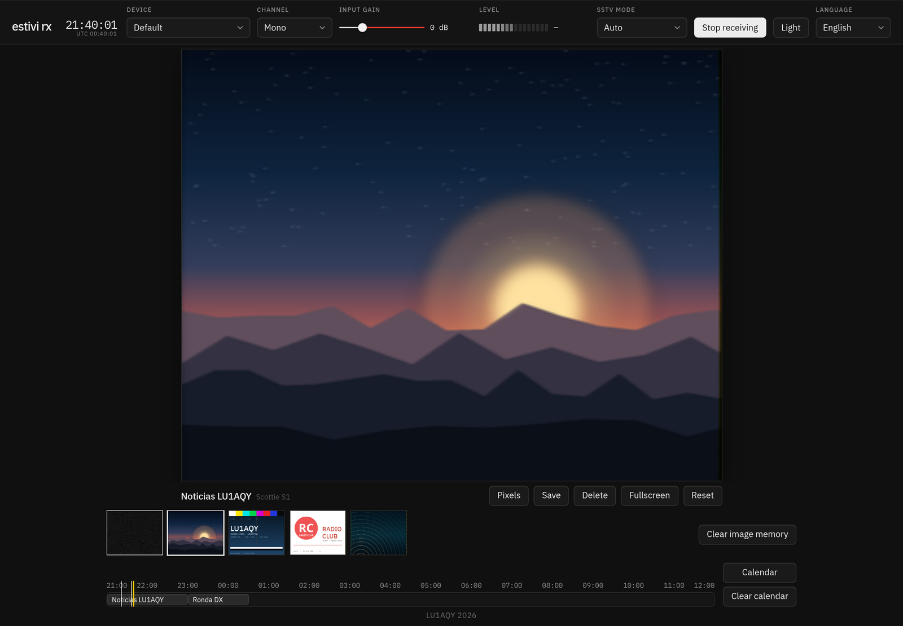
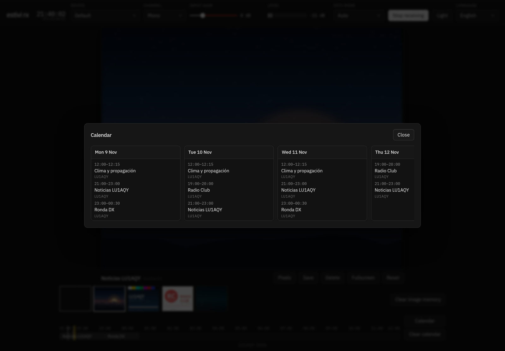
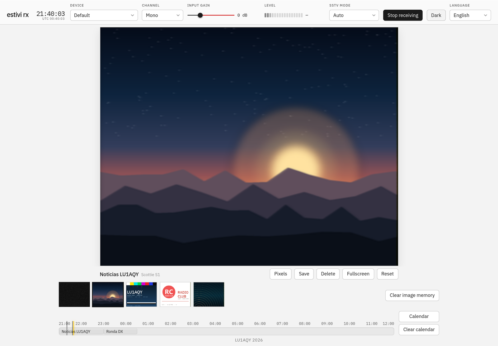

# Estivi RX

**English** · [Español](README_ES.md)

**SSTV, live in your browser.**

Estivi RX is the receiver for [Estivi](https://github.com/fluoroom/estivi-tx). It listens to a radio through your microphone, turns the audio into a frequency stream, decodes the SSTV pictures and the AX.25 program guide, and lays everything out on one page. There is no decoder on the server: the container only serves static files.

<p align="center">
  
</p>

<p align="center"><em>The visor, the timeline, and the station's hour row, all on one page.</em></p>

`Runs in the browser` · `No backend` · `Installable` · `JavaScript + Web Audio`

## What it does

- **Listens through the microphone.** Or through the receiver's line audio. Pick the input, mono, left or right, set the gain, and watch the level meter. The browser's echo cancellation, noise reduction, and automatic gain stay off.
- **Decodes the picture.** Martin, Scottie, Robot, PD and YoniQ, in color, locked from the VIS header or picked up mid-image from the line syncs.
- **Reads the station's guide.** AX.25 UI frames carry the programs, their clock, their days and what comes next. The page turns them into an hour row and a calendar without any date on the air.
- **Keeps a timeline.** Every finished or half-finished picture is stored as a lossless PNG, newest first, up to 40. Click a thumbnail to bring it back; the live decoder is always the first slot.
- **Follows the clock.** The hour row starts at the top of the current hour and runs until 12 hours past the last program. A yellow line travels with the local clock, and a thin mark sits on every saved picture.
- **Holds a bad signal together.** A short fade does not throw the picture away: the decoder waits 30% of the mode's picture time and picks up where the signal returns.
- **Installs like an app.** Chromium browsers offer **Install app**; iPhone and iPad use Share → Add to Home Screen. A service worker keeps the page, scripts, fonts and icons available offline after the first visit.
- **Remembers everything.** Pictures, the guide and the preferences live in IndexedDB, so a reload changes nothing.
- **Speaks English and Spanish.** It follows the browser's language by default; the selector can force either one.

## A closer look

<p align="center">
  
</p>

<p align="center"><em>The calendar opens today and the next 30 days, and only shows the days that have programs.</em></p>

<p align="center">
  
</p>

<p align="center"><em>The same page in the light theme. Dark is the default; the header button switches and remembers.</em></p>

## Listen now

The public receiver lives at **[estivi-rx.lu1aqy.radio](https://estivi-rx.lu1aqy.radio)**. Open it, allow the microphone, and point the microphone at your receiver's speaker, or feed it the receiver's line audio. Decoding happens in the page; the server only serves static files.

A browser only gives a page the microphone over HTTPS or on localhost, so the public copy runs behind TLS. After the first visit it opens offline.

### Run your own

```sh
docker compose up -d --build
```

Then open [http://localhost:8086](http://localhost:8086). The page asks for the microphone and starts receiving on its own. If you deny it, it stays quiet; press **Start receiving** and it will tell you why.

The container restarts unless you stop it by hand. It serves plain HTTP on host port 8086; put your nginx in front for TLS and headers.

### Check the decoder without a radio

```sh
npm test
```

The tests build synthetic Estivi audio and check the demodulator, the line times, AX.25 at 48000 and 44100, a picture at about −35 dB, mid-image starts, lost-signal recovery, translations and the guide.

## A tour of the page

### The header

From left to right: the title and a local clock with seconds, with a small UTC clock underneath; the input device and **Mono / Left / Right**; the input gain, from −12 dB to +36 dB in 0.5 dB steps, turning red above 0 dB; the level meter, about −42 dB to 0 dB; the SSTV mode and **Start / Stop receiving**; the theme button, which names the theme you switch to; and the language selector.

### The visor

The visor is the picture. Its shape follows the mode that is decoding; with nothing arriving it is 320×256. It is scaled to fit the window and the whole frame stays visible.

Under the picture, still outside it, are the program or image name with the mode in a smaller grey label after it, the resize style button (**Blur / Pixels**), **Save**, **Delete**, **Fullscreen** and **Reset**. On the live view in Auto the label reads `Auto (mode name)`, so the last mode received is not mistaken for a manual choice. Delete only appears for a saved picture, and it asks before removing that one picture.

**Blur** is the default: it smooths the received picture up to the visor size. **Pixels** keeps each received pixel a hard block. The button names the mode you get if you click it, so it reads Pixels while Blur is on and Blur while Pixels is on.

**Save** writes the received pixels as a lossless PNG named `estivi-rx-YY-MM-DD-HH-mm-MODE.png`, using the save time and the picture's mode short code. It does not include the grain or the enlargement.

**Grain** lives only on the live view. It fills the visor when nothing is arriving and the rows that have not been revealed yet while a picture is coming in. A finished picture, a picture stopped halfway, a saved thumbnail and the Save file have none.

### The timeline

The first slot is always the live decoder. Clicking it, or Reset, puts the big visor back on live. Clicking a saved picture shows that picture until Reset, another picture, the live slot, or a new reception.

A new reception shows the live picture as it arrives, then holds the finished image. The copy is stored when the reception ends and becomes the second timeline entry. The thin receive marks on the hour row open the same saved picture.

### The hour row

Under the timeline, the hour row starts at the top of the current hour and runs until 12 hours after the last program still on today's guide. That window stays put so the yellow line can travel with the clock, and it is pinned again when the clock leaves it. A thin mark sits on each saved picture whose receive time falls inside the row. The same clock hour can appear twice when the row crosses midnight.

### The calendar

Calendar opens today and the next 30 days and shows only the days that have programs. Each card is headed with the weekday, day and month, so the window runs from, say, 7 Nov to 7 Dec.

A program that crosses midnight stays one entry, `23:30–00:30`, and is not cut at 00:00; the hour row draws it as one block too, and a block still running after midnight also appears on today's card. Only blocks that overlap share lanes: two overlapping programs are split side by side, while a block with nothing beside it takes the full height in the hour row and the full width in the calendar. Same-callsign overlaps split the same way.

**Clear image memory** asks before it drops every picture and leaves the schedule alone. **Clear calendar** asks before it deletes every program.

The footer reads `LU1AQY 2026` and links to [lu1aqy.radio](https://lu1aqy.radio). The page title is `estivi rx`.

## What it receives

```text
receiver ──▶ microphone ──▶ AudioWorklet ──▶ AX.25 + SSTV ──▶ the page
```

Audio goes through a gain stage into an AudioWorklet, which demodulates the tone. AX.25 and SSTV run on the page from that frequency stream. Playback through the speakers is off.

### AX.25

AX.25 is 1200 baud Bell 202, the way Estivi sends it: mark 1200 Hz, space 2200 Hz, NRZI, LSB first, with a stuffed 0 after five 1s.

A frame is kept when it is addressed to `ESTIVI`, the control byte is UI (`0x03`), the PID is `0xF0`, and the CRC residue is `0xF0B8`. The text is either `ESTIVI 1` or `ESTIVI MODE`.

### The guide

An info frame carries the lines from `AX25.md` in the transmitter: `FREQ`, `CALL`, `NAME`, `RANGE`, `DAYS`, `DAYSLEFT`, `NEXT` and `COMMENT`. Unknown lines are ignored, and so is any text that does not start with `ESTIVI `. `COMMENT` is kept on the packet but not shown.

The frame has no date and no timezone: `HH:MM` is UTC, and the weekdays are the English abbreviations the transmitter sends (`Mon` … `Sun`). The calendar shows the local weekday in the page language. The guide stores the UTC rule and places it on this computer's local calendar, so the hour row, the calendar and the main clock show local time while the small clock in the header shows UTC.

A program with weekdays is placed on those days. `DAYSLEFT` counts from the local day it was heard, including that day; `0` means no end, and the largest value is `99`. A program stays in the guide until the calendar is cleared, even if it is not heard again; its own `DAYSLEFT` can still stop it. A common block has no `DAYS` line and no day of its own, so it is dropped, including a `NEXT` entry without weekdays.

### Labels

`ESTIVI MODE` names the piece that follows: the short mode, then an optional `WELCOME`, `BUMPER PRE`, `BUMPER POST` or `BYE`. The visor joins that to the program name (`Noticias · Welcome`). The label lasts 20 seconds and is used when the picture locks. An unknown short still labels the piece.

### Picking the mode

VIS chooses the mode. Auto ignores a VIS code that is not in the table below; a manual mode forces that mode's line timing. A picture can also start mid-image, with no VIS: the decoder locks onto four line syncs of a known mode and receives the rest of that picture. Manual uses the mode in the box; Auto uses the last mode received, and with no last mode it waits for the next VIS. The missed top of the picture is not reconstructed.

Sync is 1200 Hz, black 1500 Hz, white 2300 Hz.

| Mode | VIS |
|---|---|
| Martin M1, M2, M3, M4 | `0x2c` `0x28` `0x24` `0x20` |
| Scottie S1, S2, DX | `0x3c` `0x38` `0x4c` |
| Robot 24, 36, 72, 12 | `0x04` `0x08` `0x0c` `0x00` |
| Robot 8, 12, 24 B/N | `0x02` `0x06` `0x0a` |
| PD 50, 90, 120, 160, 180, 240, 290 | `0x5d` `0x63` `0x5f` `0x62` `0x60` `0x61` `0x5e` |
| YoniQ | `0x73`, odd parity |

A few modes have their own habits: Martin M3 and M4 send half the rows and each row is shown twice; YoniQ takes chroma from the even row; Robot 36 and Robot 12 use the line parity, even for Cr; and Scottie keeps the extra 9 ms of 1200 Hz sync after the VIS.

Only the analog YoniQ mode is decoded. The former DGT YQ clean-copy button, its FTP process and the `/dgt/` proxy are gone.

### When the signal goes away

If the signal disappears during a picture, the page holds the partial picture and keeps looking for the same mode's lines for 30% of that mode's picture time. If the signal returns, the picture continues from where it now is and the lines lost in between stay empty. If it does not return in time, the partial picture is saved to the timeline and the visor goes back to live view.

Reset gives up on the partial picture too, but only once the signal has been gone for 30% of that window (10.3 s for Martin M1, 3.2 s for Robot 36, 11.3 s for PD 120, 6.3 s for YoniQ); before then it just changes the view. A new VIS also ends the partial picture and starts the next one.

The timeout is per mode: 34.3 s for Martin M1, 10.8 s for Robot 36, 37.8 s for PD 120, and 21.0 s for YoniQ.

## Files and storage

`www/` is the page. The compose file publishes it on host port 8086; inside the container nginx serves it on 80, with `nginx.conf` sending `no-cache` for HTML, JS and CSS. The installable side lives in `manifest.webmanifest`, `sw.js` and `icons/`, all under `www/`.

`test/` builds the synthetic audio and runs the checks above. Those tests are not copied into the image.

Everything the page remembers lives in IndexedDB under the database name `estivi rx`: the pictures as lossless PNG blobs, newest first and capped at 40, plus the guide and the preferences (device, channel, gain, SSTV mode, the last mode actually received, theme, scaling choice and language). Deleting one picture removes only that one; clearing the pictures does not clear the guide, and clearing the guide does not touch the pictures.

## License

IBM Plex Sans and IBM Plex Mono in `www/fonts/` are SIL Open Font License 1.1 (`www/fonts/OFL.txt`).
