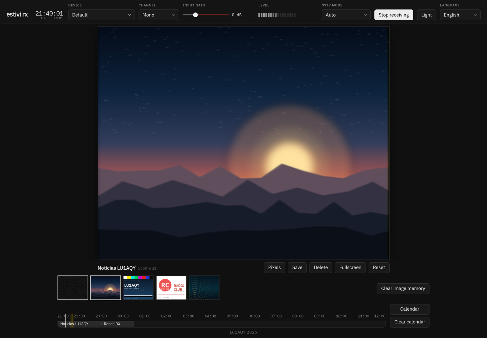
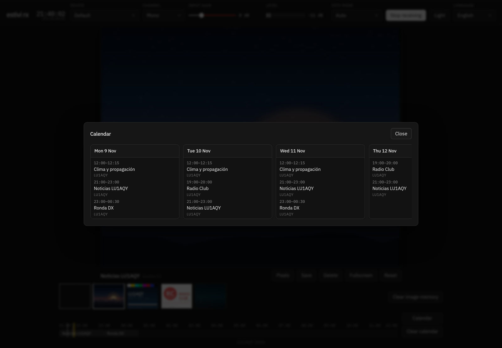
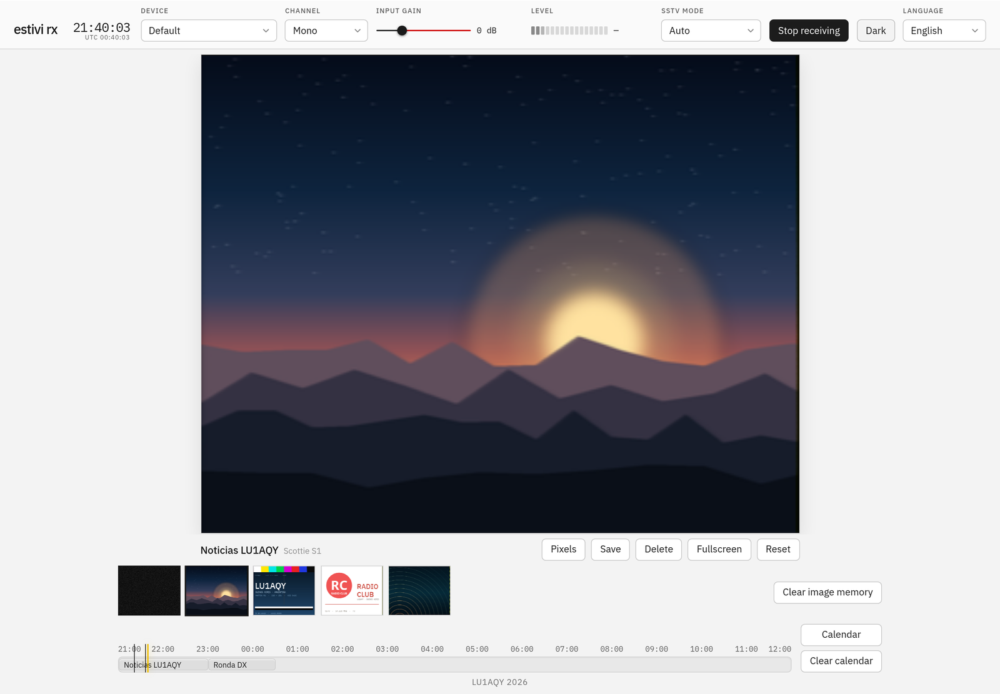

# Estivi RX

[English](README.md) · **Español**

**SSTV, en vivo en tu navegador.**

Estivi RX es el receptor de [Estivi](https://github.com/fluoroom/estivi-tx). Escucha una radio por el micrófono, convierte el audio en un flujo de frecuencias, decodifica las imágenes SSTV y la guía de programación AX.25, y lo acomoda todo en una sola página. No hay decodificador en el servidor: el contenedor solo sirve archivos estáticos.

<p align="center">
  
</p>

<p align="center"><em>El visor, la línea de tiempo y la fila de horas de la estación, todo en una página.</em></p>

`Corre en el navegador` · `Sin backend` · `Instalable` · `JavaScript + Web Audio`

## Qué hace

- **Escucha por el micrófono.** O por la salida de línea del receptor. Elegí la entrada, mono, izquierda o derecha, ajustá la ganancia y mirá el medidor de nivel. La cancelación de eco, la reducción de ruido y la ganancia automática del navegador quedan apagadas.
- **Decodifica la imagen.** Martin, Scottie, Robot, PD y YoniQ, en color, enganchada desde la cabecera VIS o tomada a mitad de imagen desde los sincronismos de línea.
- **Lee la guía de la estación.** Las tramas UI de AX.25 traen los programas, su horario, sus días y lo que viene después. La página los convierte en una fila de horas y un calendario, sin ninguna fecha en el aire.
- **Guarda una línea de tiempo.** Cada imagen terminada o a medio terminar queda como PNG sin pérdida; se guardan hasta 40, las más nuevas primero. Hacé clic en una miniatura para volver a verla; el decodificador en vivo siempre ocupa el primer lugar.
- **Sigue el reloj.** La fila de horas arranca en la hora en curso y llega hasta 12 horas después del último programa. Una línea amarilla viaja con el reloj local y una marca fina se posa en cada imagen guardada.
- **Aguanta una mala señal.** Un desvanecimiento corto no tira la imagen: el decodificador espera el 30% del tiempo de imagen del modo y retoma donde vuelve la señal.
- **Se instala como una app.** Los navegadores Chromium ofrecen **Instalar app**; en iPhone y iPad se usa Compartir → Agregar a pantalla de inicio. Un service worker deja la página, los scripts, las fuentes y los íconos disponibles sin conexión después de la primera visita.
- **Se acuerda de todo.** Las imágenes, la guía y las preferencias viven en IndexedDB, así que recargar no cambia nada.
- **Habla inglés y español.** Arranca en el idioma del navegador; el selector puede forzar cualquiera de los dos.

## Un vistazo

<p align="center">
  
</p>

<p align="center"><em>El calendario abre hoy y los próximos 30 días, y solo muestra los días que tienen programas.</em></p>

<p align="center">
  
</p>

<p align="center"><em>La misma página en el tema claro. El oscuro es el predeterminado; el botón del encabezado cambia y recuerda.</em></p>

## Escuchalo ahora

El receptor público vive en **[estivi-rx.lu1aqy.radio](https://estivi-rx.lu1aqy.radio)**. Abrí la página, dale permiso al micrófono y apuntalo al parlante de tu receptor, o pasale el audio de línea del receptor. La decodificación ocurre en la página; el servidor solo sirve archivos estáticos.

Un navegador solo le da el micrófono a una página por HTTPS o en localhost, así que la copia pública va detrás de TLS. Después de la primera visita se abre sin conexión.

### Corré tu propia copia

```sh
docker compose up -d --build
```

Después abrí [http://localhost:8086](http://localhost:8086). La página pide el micrófono y empieza a recibir sola. Si lo negás, se queda callada; apretá **Iniciar recepción** y te va a decir por qué.

El contenedor se reinicia salvo que lo pares a mano. Sirve HTTP plano en el puerto 8086 del host; poné tu nginx delante para TLS y cabeceras.

### Probá el decodificador sin radio

```sh
npm test
```

Las pruebas arman audio sintético de Estivi y revisan el demodulador, los tiempos de línea, AX.25 a 48000 y 44100, una imagen a unos −35 dB, los arranques a mitad de imagen, la recuperación después de perder la señal, las traducciones y la guía.

## Un recorrido por la página

### El encabezado

De izquierda a derecha: el título y un reloj local con segundos, con un reloj UTC chico debajo; el dispositivo de entrada y **Mono / Izquierda / Derecha**; la ganancia de entrada, de −12 dB a +36 dB en pasos de 0,5 dB, que se pone roja arriba de 0 dB; el medidor de nivel, de unos −42 dB a 0 dB; el modo SSTV y **Iniciar / Detener recepción**; el botón de tema, que nombra el tema al que cambiás; y el selector de idioma.

### El visor

El visor es la imagen. Su forma sigue al modo que está decodificando; sin nada llegando es de 320×256. Se escala para entrar en la ventana y el cuadro completo queda visible.

Debajo de la imagen, todavía afuera, están el nombre del programa o de la imagen con el modo en una etiqueta gris más chica, el botón de estilo de escala (**Desenfoque / Píxeles**), **Guardar**, **Eliminar**, **Pantalla completa** y **Restablecer**. En vivo, en Automático, la etiqueta dice `Automático (nombre del modo)`, para que el último modo recibido no se confunda con una elección manual. Eliminar solo aparece para una imagen guardada, y pregunta antes de borrar esa imagen.

**Desenfoque** es el predeterminado: suaviza la imagen recibida hasta el tamaño del visor. **Píxeles** deja cada píxel recibido como un bloque duro. El botón nombra el modo que vas a obtener si lo apretás, así que dice Píxeles mientras está Desenfoque y Desenfoque mientras está Píxeles.

**Guardar** escribe los píxeles recibidos como un PNG sin pérdida llamado `estivi-rx-YY-MM-DD-HH-mm-MODE.png`, con la hora de guardado y el código corto del modo de la imagen. No incluye el grano ni el agrandamiento.

**Grano** vive solo en la vista en vivo. Llena el visor cuando no llega nada y las filas que todavía no se revelaron mientras entra una imagen. Una imagen terminada, una imagen detenida a la mitad, una miniatura guardada y el PNG de Guardar no tienen grano.

### La línea de tiempo

El primer lugar de la línea de tiempo es siempre el decodificador en vivo. Hacer clic ahí, o en Restablecer, devuelve el visor grande a lo en vivo. Hacer clic en una imagen guardada muestra esa imagen hasta Restablecer, otra imagen, el lugar en vivo o una recepción nueva.

Una recepción nueva muestra la imagen en vivo mientras llega y después sostiene la imagen terminada. La copia se guarda cuando termina la recepción y pasa a ser la segunda entrada de la línea de tiempo. Las marcas finas de recepción en la fila de horas abren esa misma imagen guardada.

### La fila de horas

Debajo de la línea de tiempo, la fila de horas arranca en la hora en curso y llega hasta 12 horas después del último programa que sigue en la guía de hoy. Esa ventana se queda quieta para que la línea amarilla viaje con el reloj, y se vuelve a fijar cuando el reloj la deja atrás. Una marca fina se posa en cada imagen guardada cuya hora de recepción cae dentro de la fila. La misma hora del reloj puede aparecer dos veces cuando la fila cruza la medianoche.

### El calendario

**Calendario** abre hoy y los próximos 30 días y muestra solo los días que tienen programas. Cada tarjeta lleva el día de la semana, el día y el mes, así que la ventana va, por ejemplo, del 7 nov al 7 dic.

Un programa que cruza la medianoche sigue siendo una sola entrada, `23:30–00:30`, y no se corta a las 00:00; la fila de horas lo dibuja como un solo bloque, y un bloque que sigue corriendo después de la medianoche también aparece en la tarjeta de hoy. Solo los bloques que se superponen comparten carriles: dos programas superpuestos se parten uno al lado del otro, mientras que un bloque sin nada al lado ocupa toda la altura en la fila de horas y todo el ancho en el calendario. Las superposiciones del mismo indicativo se parten igual.

**Borrar imágenes** pregunta antes de tirar todas las imágenes y deja la guía quieta. **Borrar calendario** pregunta antes de borrar todos los programas.

El pie dice `LU1AQY 2026` y enlaza a [lu1aqy.radio](https://lu1aqy.radio). El título de la página es `estivi rx`.

## Qué recibe

```text
receptor ──▶ micrófono ──▶ AudioWorklet ──▶ AX.25 + SSTV ──▶ la página
```

El audio pasa por una etapa de ganancia a un AudioWorklet, que demodula el tono. AX.25 y SSTV corren en la página a partir de ese flujo de frecuencias. La reproducción por los parlantes está apagada.

### AX.25

AX.25 es Bell 202 a 1200 baudios, como lo manda Estivi: marca de 1200 Hz, espacio de 2200 Hz, NRZI, LSB primero, con un 0 metido después de cinco 1.

Una trama se conserva cuando va dirigida a `ESTIVI`, el byte de control es UI (`0x03`), el PID es `0xF0` y el residuo del CRC es `0xF0B8`. El texto es `ESTIVI 1` o `ESTIVI MODE`.

### La guía

Una trama de información trae las líneas de `AX25.md` del transmisor: `FREQ`, `CALL`, `NAME`, `RANGE`, `DAYS`, `DAYSLEFT`, `NEXT` y `COMMENT`. Las líneas desconocidas se ignoran, y también cualquier texto que no empiece con `ESTIVI `. `COMMENT` queda en el paquete pero no se muestra.

La trama no tiene fecha ni zona horaria: `HH:MM` es UTC, y los días son las abreviaturas en inglés que manda el transmisor (`Mon` … `Sun`). El calendario muestra el día local en el idioma de la página. La guía guarda la regla en UTC y la ubica en el calendario local de esta computadora, así que la fila de horas, el calendario y el reloj grande muestran hora local mientras el reloj chico del encabezado muestra UTC.

Un programa con días se ubica en esos días. `DAYSLEFT` cuenta desde el día local en que se escuchó, incluido ese día; `0` significa sin final, y el valor más grande es `99`. Un programa se queda en la guía hasta que se borra el calendario, aunque no se vuelva a escuchar; su propio `DAYSLEFT` todavía puede terminarlo. Un bloque común no tiene línea `DAYS` ni un día propio, así que se descarta, incluida una entrada `NEXT` sin días.

### Las etiquetas

`ESTIVI MODE` nombra la pieza que sigue: el modo corto y, opcionalmente, `WELCOME`, `BUMPER PRE`, `BUMPER POST` o `BYE`. El visor lo une al nombre del programa (`Noticias · Bienvenida`). La etiqueta dura 20 segundos y se usa cuando la imagen engancha. Un modo corto desconocido igual etiqueta la pieza.

### Cómo elige el modo

VIS elige el modo. Automático ignora un código VIS que no esté en la tabla de abajo; un modo manual fuerza el tiempo de línea de ese modo. Una imagen también puede empezar a mitad, sin VIS: el decodificador engancha cuatro sincronismos de línea de un modo conocido y recibe el resto de esa imagen. La elección manual usa el modo del cuadro; Automático usa el último modo recibido y, sin último modo, espera el próximo VIS. La parte de arriba que se perdió no se reconstruye.

El sincronismo es de 1200 Hz, el negro de 1500 Hz y el blanco de 2300 Hz.

| Modo | VIS |
|---|---|
| Martin M1, M2, M3, M4 | `0x2c` `0x28` `0x24` `0x20` |
| Scottie S1, S2, DX | `0x3c` `0x38` `0x4c` |
| Robot 24, 36, 72, 12 | `0x04` `0x08` `0x0c` `0x00` |
| Robot 8, 12, 24 B/N | `0x02` `0x06` `0x0a` |
| PD 50, 90, 120, 160, 180, 240, 290 | `0x5d` `0x63` `0x5f` `0x62` `0x60` `0x61` `0x5e` |
| YoniQ | `0x73`, paridad impar |

Algunos modos tienen sus costumbres: Martin M3 y M4 mandan la mitad de las filas y cada fila se muestra dos veces; YoniQ toma la crominancia de la fila par; Robot 36 y Robot 12 usan la paridad de línea, par para Cr; y Scottie guarda los 9 ms extra de sincronismo de 1200 Hz después del VIS.

Solo se decodifica el modo analógico YoniQ. El antiguo botón de copia limpia DGT YQ, su proceso por FTP y el proxy `/dgt/` ya no están.

### Cuando se va la señal

Si la señal desaparece durante una imagen, la página sostiene la imagen parcial y sigue buscando las líneas del mismo modo durante el 30% del tiempo de imagen de ese modo. Si la señal vuelve, la imagen continúa desde donde está ahora y las líneas perdidas en el medio quedan vacías. Si no vuelve a tiempo, la imagen parcial se guarda en la línea de tiempo y el visor vuelve a la vista en vivo.

Restablecer también abandona la imagen parcial, pero solo cuando la señal se fue durante el 30% de esa ventana (10,3 s para Martin M1, 3,2 s para Robot 36, 11,3 s para PD 120, 6,3 s para YoniQ); antes de eso solo cambia la vista. Un VIS nuevo también termina la imagen parcial y arranca la siguiente.

El tiempo de espera es por modo: 34,3 s para Martin M1, 10,8 s para Robot 36, 37,8 s para PD 120 y 21,0 s para YoniQ.

## Archivos y almacenamiento

`www/` es la página. El archivo compose la publica en el puerto 8086 del host; dentro del contenedor nginx la sirve en el 80, con `nginx.conf` mandando `no-cache` para HTML, JS y CSS. La parte instalable vive en `manifest.webmanifest`, `sw.js` e `icons/`, todo bajo `www/`.

`test/` arma el audio sintético y corre las pruebas de arriba. Esas pruebas no se copian a la imagen.

Todo lo que la página recuerda vive en IndexedDB bajo el nombre de base `estivi rx`: las imágenes como blobs PNG sin pérdida, las más nuevas primero y con un tope de 40, más la guía y las preferencias (dispositivo, canal, ganancia, modo SSTV, el último modo realmente recibido, tema, elección de escala e idioma). Borrar una imagen elimina solo esa; borrar las imágenes no toca la guía, y borrar la guía no toca las imágenes.

## Licencia

IBM Plex Sans e IBM Plex Mono en `www/fonts/` son SIL Open Font License 1.1 (`www/fonts/OFL.txt`).
